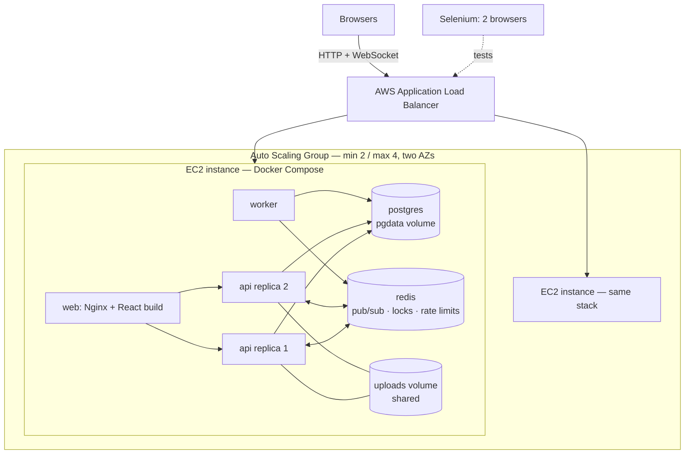

# FlowBoard — Real-time Kanban Project Management on AWS

**Course:** CSC418 DevOps for Cloud Computing — Lab Mid Exam
**Student:** _<your name / registration no.>_

FlowBoard is a collaborative project-management app in the style of Jira/Trello. Teams create
**workspaces**, invite members with a code, and manage **projects** on Kanban boards. Every change
(new task, drag-and-drop, comment, assignment) appears **instantly on every teammate's screen**
through WebSockets, even when the users are connected to different servers.

It runs as **six containers** with Docker Compose: an Nginx web tier, **two replicas** of a Node.js
API, a background worker, PostgreSQL and Redis. Two EC2 instances run the stack behind an
**Application Load Balancer** managed by an **Auto Scaling Group**. A 15-step **Selenium** suite drives
two browsers at once to prove the real-time collaboration works.

## Features

| Area | Details |
|---|---|
| Accounts | Register/login, bcrypt password hashing, JWT sessions, **Redis-backed rate limiting** on auth |
| Workspaces | Create, **invite code / invite link**, roles **owner › admin › member › viewer** enforced on every API call |
| Projects | Keys like `WEB` → tasks `WEB-1`, `WEB-2` (atomic per-project counter); colour; description |
| Kanban board | Custom columns, **WIP limits** (enforced server-side), "done" columns, reorder columns |
| Drag & drop | Pointer-event drag between/within columns, optimistic UI, **fractional indexing** with automatic rebalancing |
| Tasks | Priority, assignee, due date, story points, labels, **checklists**, comments with **@mentions**, file attachments, full activity history |
| Real-time | Live board updates, **"Viewing now" presence** avatars, live notification bell — synced across API replicas and instances via the **Socket.IO Redis adapter** |
| Notifications | Assigned, mentioned, commented, completed, member joined, **due soon / overdue** (from the worker) |
| Background worker | Due-date reminders + cleanup, **Redis distributed lock** so only one worker runs each job |
| Analytics | Completion %, burndown, created-vs-completed throughput, WIP per column, workload per person, cycle time |
| Ops | `/api/health` (DB + Redis + worker), instance/container shown in the sidebar, JSON logs, graceful shutdown |

## Architecture



| Container | Image | Role | Networks |
|---|---|---|---|
| `web` | **multi-stage**: Node builds React → `nginx:1.28-alpine` serves it | static files, reverse proxy, **load-balances API replicas**, WebSocket upgrade | frontend |
| `api` ×2 | **multi-stage** `node:22-alpine`, non-root | REST API + Socket.IO server | frontend + backend |
| `worker` | same image as `api`, different `command` | scheduled jobs, pushes notifications via Redis | backend |
| `db` | `postgres:16-alpine` | relational data (12 tables) | backend |
| `redis` | `redis:7-alpine`, password + AOF persistence | WebSocket fan-out, presence, locks, rate limits | backend |

Only port **80** is published. The `backend` network is `internal: true`: the database, Redis and the
worker have no internet access, and Nginx cannot reach the database.

### Why Redis is needed
A browser's WebSocket is connected to **one** API replica, but the change it must hear about may
be handled by **another** replica. Every API replica publishes its events to Redis and subscribes to
everyone else's (Socket.IO Redis adapter), so the event reaches every connected browser. The worker
has no WebSocket server at all; it publishes notifications with the Socket.IO **Redis emitter**.

## Project structure

```
flowboard/
├── api/                         # Node.js 22 · Express 5 · Socket.IO · pg · redis · zod
│   ├── Dockerfile               # multi-stage, non-root, HEALTHCHECK
│   └── src/
│       ├── server.js            # HTTP + WebSocket server, graceful shutdown
│       ├── worker.js            # background jobs (same image, different command)
│       ├── lib/                 # db, redis, auth, access control, realtime, ordering algorithm
│       └── routes/              # auth, workspaces, projects, tasks, notifications, health
├── web/                         # React 18 + Vite SPA
│   ├── Dockerfile               # multi-stage: node build -> nginx
│   ├── nginx.conf               # upstream load balancing, WebSocket proxy, caching, security headers
│   └── src/                     # pages (Board, Analytics, …), components (TaskModal, Charts, …)
├── db/init/01-schema.sql        # 12 tables, constraints, indexes
├── docker-compose.yml           # 6 containers, 2 networks, 3 named volumes
├── docker-compose.selenium.yml  # Selenium Grid (2 sessions) + test-runner container
├── tests/selenium/              # pytest + Selenium WebDriver, 15 steps, 2 browsers
├── scripts/                     # one demo script per exam task
├── aws/user-data.sh             # EC2 bootstrap for the Launch Template
└── docs/  AWS-DEPLOYMENT.md · VIVA-NOTES.md
```

## Exam tasks → evidence

| # | Task (marks) | Where | How to demo |
|---|---|---|---|
| 1 | Load Balancer & Auto Scaling (2) | `aws/user-data.sh`, `docs/AWS-DEPLOYMENT.md` | Open the ALB DNS name — the sidebar shows the EC2 instance & container. `bash scripts/05-loadbalancer-check.sh http://<alb>` shows both instances. Terminate one → the ASG replaces it |
| 2 | Linux administration (1) | `scripts/01-linux-admin.sh` | `PAUSE=1 bash scripts/01-linux-admin.sh` — system commands, `mkdir`, `chown`, `chmod` octal + symbolic, `.env` → `600` |
| 3 | Docker install & images (2) | `api/Dockerfile`, `web/Dockerfile`, `scripts/02-docker-basics.sh` | Builds both multi-stage images, history, inspect, run/exec/stop/rm |
| 4 | Docker volumes (1) | `pgdata`, `redisdata`, `uploads` in compose; `scripts/03-volume-persistence.sh` | Deletes and recreates the DB and Redis containers — data is still there; a file written by API replica 1 is read by replica 2 |
| 5 | Docker Compose (2) | `docker-compose.yml`, `scripts/06-scale-and-realtime.sh` | 6 containers, healthchecks, `depends_on: service_healthy`, DNS discovery, scaling `--scale api=3` |
| 6 | Selenium testing (2) | `tests/selenium/test_flowboard.py` | `bash scripts/04-run-selenium.sh http://<alb>` → 15 passing steps, HTML report, screenshots |

## Run locally (Docker Desktop)

```bash
cp .env.example .env          # PowerShell: copy .env.example .env
docker compose up -d --build
docker compose ps             # wait until all 6 are "healthy"
```

Open <http://localhost>, register, create a workspace and a project. Open a **second browser
(or an incognito window)**, register another user, join with the invite code, and open the same board —
drag a card in one window and watch it move in the other.

```bash
docker compose logs -f api worker           # structured JSON logs from both replicas + worker
docker compose exec db psql -U flowboard    # SQL shell
docker compose exec redis redis-cli -a "$REDIS_PASSWORD" MONITOR   # watch real-time traffic
docker compose up -d --scale api=3          # add a replica
docker compose down                         # stop (volumes kept)
```

### Developing without Docker
`api`: `npm install && DB_HOST=localhost REDIS_URL=redis://localhost:6379 npm run dev`
`web`: `npm install && npm run dev` (Vite proxies `/api` and `/socket.io` to `localhost:3000`).

## Selenium tests

```bash
# Browsers in Docker (no local Chrome needed); watch them at http://<host>:7900 (password: secret)
bash scripts/04-run-selenium.sh http://<alb-dns-name>

# Or with your own Chrome (Windows PowerShell):
cd tests/selenium; pip install -r requirements.txt
$env:BASE_URL="http://<alb-dns-name>"; $env:HEADLESS="0"; pytest
```

The suite registers two users in two browsers and checks: login page, health, validation errors,
workspace + invite code, project with default columns, quick-add, task modal (priority, checklist,
comment), **drag-and-drop that survives a reload**, joining via invite code, **a task created by A
appearing on B's screen without refresh**, **presence avatars**, **a move by A seen by B**, a **live
notification** when A assigns B, analytics, and which instances answered.

## REST API (main endpoints)

| Method | Path | Min. role |
|---|---|---|
| GET | `/api/health`, `/api/health/live` | public |
| POST | `/api/auth/register`, `/api/auth/login` (rate-limited) | public |
| GET/POST | `/api/workspaces` · POST `/api/workspaces/join` | logged in |
| GET/PATCH/DELETE | `/api/workspaces/:id` | viewer / admin / owner |
| PATCH/DELETE | `/api/workspaces/:id/members/:userId` | admin |
| POST | `/api/workspaces/:id/projects` | member |
| GET | `/api/projects/:id` (whole board in one call) · `/analytics` · `/activity` | viewer |
| POST | `/api/projects/:id/tasks` · `/columns` · `/labels` | member |
| GET/PATCH/DELETE | `/api/tasks/:id` | viewer / member |
| POST | `/api/tasks/:id/move` `{columnId, index}` (WIP check + fractional index) | member |
| POST | `/api/tasks/:id/checklist` · `/comments` · `/attachments` | member |
| GET | `/api/me/tasks` · `/api/notifications` | logged in |

**WebSocket events:** client → `board:join`, `board:leave`; server → `task:upsert`, `task:deleted`,
`board:refresh`, `presence`, `notification`, `comment:new`, `project:deleted`.

## DevOps practices

- Multi-stage builds for both images; dependency layers cached separately from source
- One image, two roles (API and worker) — build once, run many
- Stateless API → horizontally scalable (`deploy.replicas: 2`, `--scale`), Nginx re-resolves DNS to find new replicas
- Healthchecks at every level: Docker `HEALTHCHECK`, Compose `service_healthy` ordering, ALB target-group check on `/api/health` (DB + Redis)
- Network segmentation (internal backend network), secrets only in `.env` (`chmod 600`, git-ignored), passworded Redis, non-root containers
- Graceful shutdown (SIGTERM → close sockets → drain → close pools), automatic DB/Redis reconnect
- Structured JSON logs with rotation; `X-Served-By` header and UI footer for traceability
- Idempotent infrastructure bootstrap through EC2 user data
